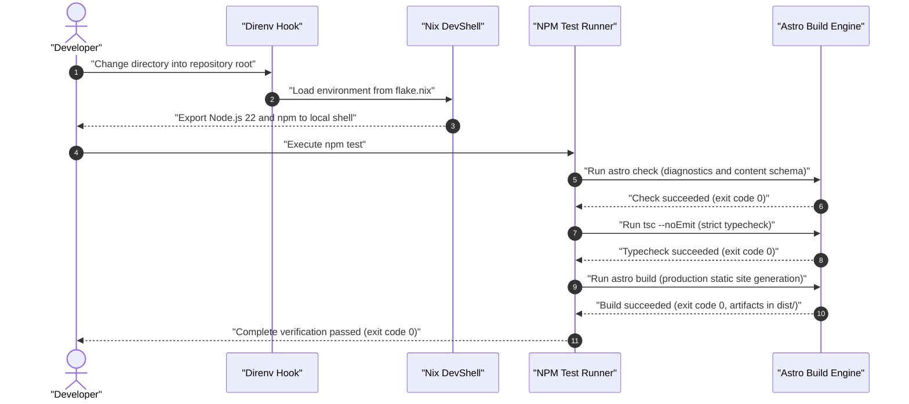
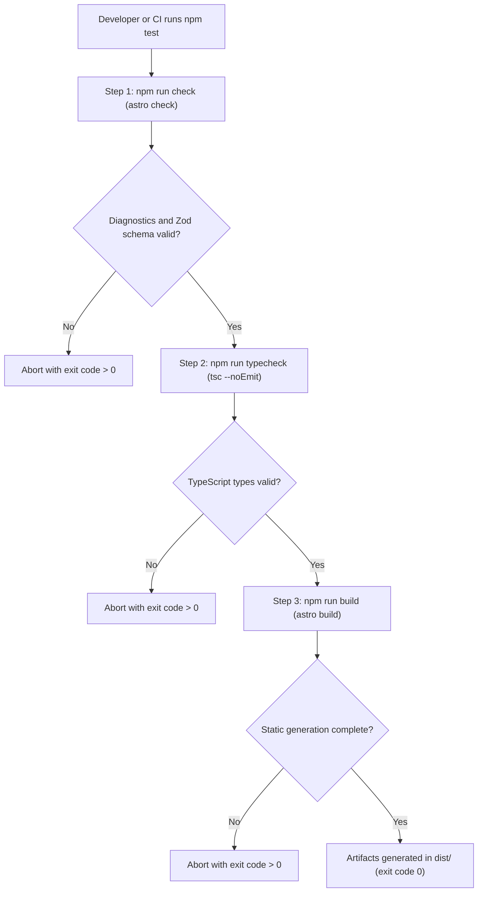

# UC-env_local_verification: Entorno Local Reproducible y Verificacion Determinista

> **Trazabilidad SDD:** Derivado de la spec `specs/001_entorno_local_verificacion_spec.md` (Requisitos: `RF-01` a `RF-07`, `RNF-01`).

## 1. Ficha de Intencion
- **ID:** UC-env_local_verification
- **Actor Principal:** Developer / Automated Test Runner
- **Disparador:** Activacion de entorno (`direnv` / `nix develop`) o invocacion de suite de verificacion (`npm test`)
- **Precondiciones:**
  - Repositorio clonado localmente en host Linux (NixOS u otra distribucion con Nix habilitado).
  - Gestor de paquetes Nix disponible con soporte de Flakes.
- **Invariantes de Negocio:**
  - Runtime hermetico garantizado con Node.js en version >= 22.
  - Ejecucion estricta fail-fast (`&&`) en la suite de verificacion: ante el primer fallo en `check` o `typecheck`, el pipeline se interrumpe inmediatamente sin invocar `build`.
  - Inmutabilidad del sistema anfitrion: no se requieren privilegios de superusuario (`root`) ni se alteran paquetes globales.

## 2. Diagrama de Interaccion del Sistema (SSD)

## 3. Arbol de Decisiones (Flujo de Verificacion)

## 4. Caminos Alternativos y Catalogo de Errores

| Error Code / Fallo | Causa Raiz | Respuesta / Efecto |
| :--- | :--- | :--- |
| `ERR_NIX_MISSING` | Binario `nix` no disponible en la maquina host | El entorno no puede instanciarse declarativamente; se emite error en shell standard. |
| `ERR_CONTENT_SCHEMA` | Frontmatter con tipos incorrectos o campos faltantes en archivos MDX | `astro check` reporta diagnostico con archivo y linea, abortando la cadena con codigo `1`. |
| `ERR_TYPECHECK` | Tipos inconsistentes o componentes no resueltos en archivos `.ts` | `tsc --noEmit` imprime lista de errores TS y aborta el pipeline sin compilar. |
| `ERR_BUILD_FAILURE` | Error de sintaxis en plantillas Astro o fallo en optimizacion de imagenes | `astro build` aborta la generacion y limpia artefactos parciales retornando codigo `1`. |

## 5. Postcondiciones y Efectos Secundarios
- **Estado Persistido:**
  - Creacion o actualizacion del directorio `dist/` con las paginas HTML generadas (`dist/index.html`, etc.).
  - Cache local temporal en `.astro/` y `.direnv/`.
- **Eventos Emitidos:**
  - Registros de diagnostico y conteo de paginas generadas en la salida estandar (`stdout`).
- **Auditoria:**
  - Validacion sellada formalmente en `.seb/seb-audit.db` y `.seb/seb.lock` a traves de `.seb/bin/seb verify entorno_local_verificacion`.
